# Anleitung: ReBeL-Simulation einrichten und im Unterricht nutzen

Inhalt

1. [So funktioniert es](#1-so-funktioniert-es)
2. [Voraussetzungen](#2-voraussetzungen)
3. [Installation auf Proxmox](#3-installation-auf-proxmox)
4. [Robotermodell aus iRC erzeugen](#4-robotermodell-aus-irc-erzeugen)
5. [Schüler-PCs vorbereiten](#5-schüler-pcs-vorbereiten)
6. [Im Unterricht: Schülerseite](#6-im-unterricht-schülerseite)
7. [Lehrerbereich](#7-lehrerbereich)
8. [Baukasten](#8-baukasten)
9. [Taster, Leuchtmelder und Sensoren](#9-taster-leuchtmelder-und-sensoren)
10. [Update](#10-update)
11. [Befehle im Container](#11-befehle-im-container)
12. [Fehlersuche](#12-fehlersuche)

---

## 1. So funktioniert es

- Die Schüler programmieren in **iRC V15** auf ihrem PC, mit der iRC-eigenen Simulation.
- Für jeden Schüler-PC startet im Container eine **Webots-Simulation**. Sie verbindet sich mit der iRC-Steuerung
  des Schüler-PCs (CRI, Port 3921) und **hört nur mit**: Der Roboter in Webots fährt genauso wie in iRC,
  greift echte Werkstücke und legt sie ab. iRC behält die Kontrolle.
- Alle öffnen im **Browser** die Startseite `http://<container>` (Port 80; der frühere Port 8080 leitet dorthin um).
  Schüler starten dort ihre Roboterumgebung, Lehrkräfte melden sich über „Anmeldung Lehrkraft“ an. Der PC wird an seiner IP
  erkannt, jeder Schüler sieht nur seine eigene Simulation.
- **Taster und Sensoren** setzen über die App-Schnittstelle von iRC (Port 5000) echte digitale Eingänge.

```
iRC auf dem Schüler-PC ──CRI (3921)──▶ Webots je Platz im Container ──Browser (80)──▶ Schüler
        ▲                                   │
        └──── App-Schnittstelle (5000) ◀────┘
```

## 2. Voraussetzungen

**Proxmox**
- Proxmox VE 8 mit Internetzugang (für Ubuntu-Vorlage, Webots und dieses Repository).
- Richtwerte für 10 gleichzeitige Simulationen: **4 Kerne, 6 GB RAM, 20 GB Platte**.
  Gemessen: je Simulation etwa 400 MB RAM und 5 % eines Kerns.

**Netz** (wichtig für die IT)
- Schul-PCs → Container: **TCP 80** (Startseite und 3D-Ansicht der Schüler) und **TCP 443** (Lehrerbereich,
  verschlüsselt); 8080 nur noch als Umleitung für alte Lesezeichen. Eine Firewall im Container
  (`rebel-sim-firewall`) lässt von außen nur diese Ports und SSH (22) zu.
- Container → Schul-PCs: **TCP 3921** (iRC-Steuerung) und **TCP 5000** (App-Schnittstelle von iRC).
  Die Windows-Firewall-Regel „robotcontrol“, die iRC mitbringt, muss auch im **Domänenprofil** gelten.
- Zwischen Schul-PCs und Container **kein NAT/Proxy**, sonst stimmt die Erkennung an der IP nicht.
- Die Browser brauchen Internet: Die 3D-Ansicht lädt `WebotsView.js` von cyberbotics.com,
  der Baukasten three.js von cdn.jsdelivr.net.

**Schüler-PCs**
- igus Robot Control **V15** mit ReBeL-Projekt (REBEL-6DOF-03).
- **Windows-Benutzername ohne Umlaute.** iRC V15 startet sonst nicht
  („Datenverzeichnispfad scheint nicht zu existieren“). Das ist ein Fehler in iRC und betrifft auch Schülerkonten.

## 3. Installation auf Proxmox

1. In der Proxmox-Oberfläche den Knoten wählen, **Shell** öffnen.
2. Diesen Befehl einfügen:

   ```bash
   bash -c "$(curl -fsSL https://raw.githubusercontent.com/mgoebel89/RoboterSimulationDRS/main/proxmox/rebel-sim.sh)"
   ```

3. **„Neuen Container anlegen“** wählen und die Fragen beantworten (die Vorgaben passen meist):
   CT-ID, Hostname (z.B. `rebel-sim`), Kerne, RAM, Platte, Speicher, Netzwerk-Brücke,
   IP-Adresse (feste Adresse empfohlen, z.B. `192.168.7.1/16`, oder `dhcp`), Gateway, Root-Passwort.
4. Das Skript lädt die Ubuntu-24.04-Vorlage, legt den Container an (unprivilegiert, `nesting=1`,
   Start beim Booten) und installiert darin alles. Das dauert einige Minuten.
5. Zum Schluss zeigt es die Adresse der **Einrichtung** und den **Einrichtungscode**, z.B.
   `https://192.168.7.1/einrichtung` und `4821-7730-1956`. Den Code abschreiben.
6. Die Adresse an einem Lehrer-PC im Browser öffnen und dem **Einrichtungsassistenten** folgen:
   - **Verschlüsselte Verbindung:** Beim ersten Mal erscheint die Anleitung zum Stammzertifikat (siehe Abschnitt 7).
     Ohne Zertifikat geht es auch: Der Browser warnt, über „Erweitert“ → „Weiter zu …“ geht es weiter.
   - **Willkommen:** Einrichtungscode eingeben.
   - **Admin-Konto:** eigenes Konto anlegen, danach ist man angemeldet.
   - **Robotermodell:** iRC-Daten hochladen (Abschnitt 4).
   - **Lehrkräfte** und **Einstellungen** (Höchstzahl der Simulationen, Stundenende, Logo): freiwillig.
   - **Schüler-PCs:** App für iRC herunterladen, Text für die IT kopieren, Verbindung zu einem PC prüfen.
   - **Fertig:** Roboterumgebungen für Schüler freigeben.

Der Code gilt nur, bis das erste Konto angelegt ist. Vergessen? In der Proxmox-Konsole des Containers
`rebel-sim-einrichtung` eingeben. Der Assistent bleibt danach für Admins erreichbar:
Lehrerbereich → **Einstellungen** → **Einrichtungsassistent öffnen** (z.B. für neue iRC-Daten nach einem iRC-Update).

Das Root-Passwort aus dem Skript gilt für die Konsole und für SSH (das Skript erlaubt root die Anmeldung mit
Passwort; Ubuntu lässt root sonst nur mit Schlüssel herein). Für die Einrichtung ist SSH nicht nötig.

Ohne das Proxmox-Skript, z.B. in einem schon vorhandenen Ubuntu-24.04-Container, als root:

```bash
bash -c "$(curl -fsSL https://raw.githubusercontent.com/mgoebel89/RoboterSimulationDRS/main/install/rebel-sim-install.sh)"
```

Auch dieses Skript zeigt am Ende Adresse und Einrichtungscode. Danach erreichbar: **`http://<container>`** –
Startseite mit allen freigegebenen Roboterumgebungen (Schüler) und dem Knopf „Anmeldung Lehrkraft“.

## 4. Robotermodell aus iRC erzeugen

Das Modell des ReBeL und des Greifers stammt aus iRC und gehört igus. Es steht deshalb nicht im Repository,
sondern wird einmal im Container erzeugt. Das geht im **Einrichtungsassistenten** (Schritt „Robotermodell“):

1. **irc-daten-export.cmd herunterladen** und auf einem Windows-PC mit iRC V15 doppelklicken. Warnt Windows
   („Der Computer wurde durch Windows geschützt“): *Weitere Informationen* → *Trotzdem ausführen*.
   Das Skript findet iRC selbst und legt `irc-daten.zip` (etwa 1,5 MB) auf den Desktop:
   Roboter `REBEL-6DOF-03` und Greifer Schunk EGP 40 und 25.
2. Die Datei im Assistenten **hochladen** (auswählen oder hineinziehen). Das Modell wird sofort erzeugt
   (bis zu einer Minute). Mit „Probebild erzeugen“ fotografiert Webots die Beispielwelt zur Kontrolle.

Sind Skripte auf dem PC gesperrt: den Ordner `Data` aus `C:\Program Files\iRC-igusRobotControl-V15` als ZIP packen
(Rechtsklick → *Senden an* → *ZIP-komprimierter Ordner*, etwa 270 MB) und diese ZIP hochladen. Übernommen werden nur
der Roboter und die Dateien `Schunk_EGP*`.

Ohne Browser geht es weiterhin im Container: die ZIP z.B. mit WinSCP nach `/root/` kopieren (bzw. auf den
Proxmox-Host und dort `pct push <CT-ID> irc-daten.zip /root/irc-daten.zip`), dann `rebel-sim-modell /root/irc-daten.zip`.
Das Exportskript gibt es auch als PowerShell-Datei: [`tools/irc_daten_export.ps1`](../tools/irc_daten_export.ps1).

Die Daten bleiben unter `/var/lib/rebel-sim/irc`; bei jedem Update wird das Modell daraus neu erzeugt.

| Profiltisch mit Magazin | Basisplatte mit Anschlagkante |
|---|---|
| 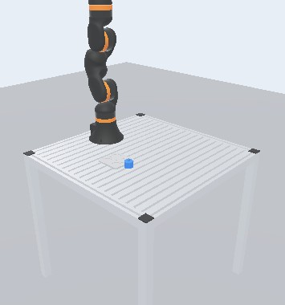 | 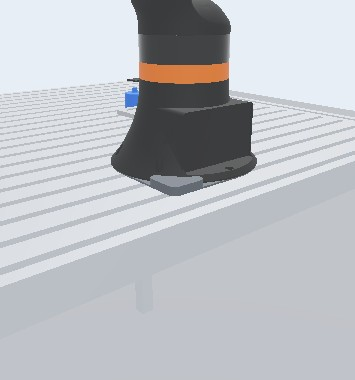 |

## 5. Schüler-PCs vorbereiten

1. **iRC V15** installieren, ReBeL-Projekt laden. Die iRC-Oberfläche startet ihre Steuerung selbst auf Port 3921,
   eine CRI-Einstellung ist nicht nötig.
2. **Werkzeug** in iRC wählen: `Schunk_EGP40_RebelMountingPlate` (Standardgreifer EGP 40) bzw. das Werkzeug
   der Welt. Für eigene Greifer im Lehrerbereich unter **Greifer** auf **Werkzeug für iRC** klicken, das ZIP entpacken und
   `installieren.cmd` doppelklicken: Es kopiert XML und Modelle nach `%APPDATA%\RobotControl\V15\Data\Tools`.
   iRC neu starten, Werkzeug wählen. Dann meldet iRC denselben TCP wie die Simulation und der Abgleich zeigt „TCP“.
3. **App „WebotsSim“** (nur für Welten mit Tastern oder Sensoren): In iRC unter **Apps** die Datei
   [`deploy/irc_app/WebotsSim.zip`](../deploy/irc_app/WebotsSim.zip) installieren und die App **aktivieren**.
   Sie enthält kein Programm; sie erlaubt der Simulation nur, in der iRC-Simulation Eingänge zu setzen.
4. Firewall: Regel „robotcontrol“ für das Domänenprofil freigeben (siehe Voraussetzungen).

## 6. Im Unterricht: Schülerseite

1. **Zuerst iRC starten**, dann im Browser `http://<container>` öffnen.
2. Roboterumgebung wählen und **„Simulation starten“**. Oben steht, wie viele Simulationen noch frei sind.

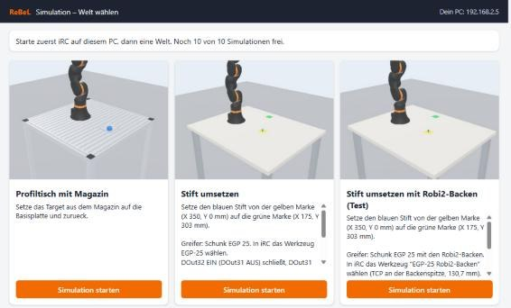

3. Die 3D-Ansicht verbindet sich; oben links steht „iRC verbunden“. In iRC verfahren oder ein Programm starten,
   der ReBeL in Webots fährt mit.

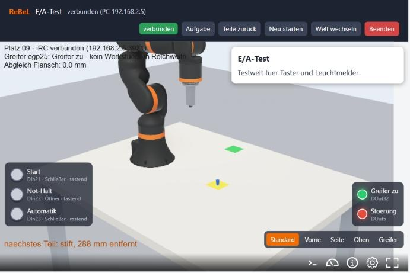

**Knöpfe oben**
- **Aufgabe** öffnet rechts eine Seitenleiste mit dem Aufgabentext (und ggf. dem Arbeitsblatt als PDF); das 3D-Bild
  wird schmaler, nicht verdeckt. Beim Start ist sie zu; × oder erneuter Klick schließt sie.
- **Teile zurück** legt alle Werkstücke sofort wieder auf ihre Startlage, ohne Neustart.
- **Neu starten** startet Webots neu (nur nötig, wenn etwas hängt; dauert einige Sekunden).
- **Umgebung wechseln**, **Beenden**.

**Greifer Schunk EGP 40** (und EGP 25): DOut32 EIN (DOut31 AUS) schließt, DOut31 EIN (DOut32 AUS) öffnet.
Ohne eigene Backen stehen die Backenträger des EGP 40 offen 28 mm und geschlossen 16 mm auseinander, Hub je Backe
6 mm (Datenblatt; EGP 25: 17 mm / 11 mm, 3 mm). Gegriffen wird, was zwischen die offenen Backen passt, breiter als
der Spalt bei geschlossenem Greifer ist und auf Backenhöhe liegt; das Teil rutscht in die Mitte.

**Einteachen:** iRC und Browser nebeneinander legen.
- Unten links zeigt die **Einteach-Hilfe**, wie weit der TCP noch von der Greifstellung des nächsten Werkstücks
  entfernt ist, in iRC-Koordinaten (z.B. `target1: noch X +2 Y -1 Z -12 mm`). Grün, sobald der Griff klappen würde.
- Unten rechts: **Ansichten** Standard, Vorne, Links, Rechts (aus Sicht des Roboters), Oben und **Teach**: Die Kamera
  kreist in etwa 25 cm Abstand um die Greiferspitze und folgt ihr. Ziehen mit der mittleren (oder linken) Taste dreht
  um die Spitze, das Rad ändert den Abstand; so sieht man beim Einteachen den Spalt zwischen Backen und Werkstück.
- **Namen** blendet Schilder mit den Namen der Werkstücke, Aufbauten und Sensorflächen ins 3D-Bild ein oder aus
  (die Wahl merkt sich der Browser). Werkstücke behalten ihr Schild auch, während der Greifer sie trägt; liegen
  Schilder übereinander, weicht eines nach oben aus. Die Namen vergibt der Baukasten (Feld „Name“).
- Maus **wie in iRC**: mittlere Taste ziehen dreht, rechte Taste ziehen verschiebt, das Rad zoomt zum Mauszeiger.
  Die linke Taste dreht ebenfalls (für Touchpads ohne mittlere Taste; ein Gelenk ziehen geht hier nicht, den Roboter
  bewegt iRC).

Die Simulation endet automatisch nach 15 Minuten ohne iRC und zu den eingestellten Stundenenden.

## 7. Lehrerbereich

Auf der Startseite **„Anmeldung Lehrkraft“** (oder `https://<container>/lehrer`), Anmeldung mit dem Lehrerkonto.

**Verschlüsselt (https):** Der Lehrerbereich läuft nur über https, damit Passwörter und die Anmeldung nicht im
Schulnetz mitgelesen werden können; die Schülerseiten bleiben bei http. Der Container hat dafür eine eigene kleine
Zertifizierungsstelle. Ihr Stammzertifikat muss **einmal je Lehrer-PC** (bzw. Windows-Benutzer) installiert werden;
die Lehrerseite führt automatisch dorthin, solange es fehlt:

1. `http://<container>/lehrer` öffnen und „Stammzertifikat herunterladen“ (oder direkt `http://<container>/ca.crt`).
2. Datei öffnen, unter „Details“ den Fingerabdruck mit dem auf der Seite vergleichen.
3. „Zertifikat installieren …“ → „Aktueller Benutzer“ → „Alle Zertifikate in folgendem Speicher speichern“ →
   „Vertrauenswürdige Stammzertifizierungsstellen“ → Fertigstellen, Sicherheitswarnung mit „Ja“ bestätigen.
4. Browser ganz schließen und neu öffnen. Edge und Chrome nutzen den Windows-Speicher; Firefox: Einstellungen →
   Datenschutz & Sicherheit → Zertifikate anzeigen → Zertifizierungsstellen → Importieren.

Für viele PCs kann die IT das Stammzertifikat per Gruppenrichtlinie verteilen. Die Zertifizierungsstelle darf nur
Zertifikate für das Netz des Containers (/16) und seinen Namen ausstellen, nicht für andere Webseiten. Das Zertifikat
der Seite erneuert der Container selbst (`rebel-sim-tls`, wöchentlich geprüft). Zieht der Container in ein anderes
Netz um, entsteht eine neue Zertifizierungsstelle; dann das Stammzertifikat auf den Lehrer-PCs neu installieren.

Links steht die Seitenleiste mit allen Bereichen, oben auf jeder Seite die passenden Knöpfe. Eine **Roboterumgebung**
(früher „Welt“) ist ein Tisch mit Teilen, Greifer und Aufgabe, so wie ihn die Schüler starten.

- **Simulationen:** alle laufenden Simulationen mit Ampel (iRC verbunden?), **Ansehen** (3D-Ansicht des Platzes mit
  Teile zurück, Neu starten, Beenden), **Teile zurück**, **Neu starten**, **Beenden**, Alle beenden. Den Roboter selbst
  bewegt immer iRC am Schüler-PC; eine Steuerung aus dem Browser gibt es bewusst nicht (sie würde iRC aussperren).
- **Roboterumgebungen:** Liste mit Suche. Der Knopf „freigegeben/gesperrt“ schaltet direkt um; ein Klick auf die Zeile
  öffnet den Dialog: Titel, Aufgabentext, **Greifer**, Freigabe, Vorschaubild, Arbeitsblatt (PDF) und **Löschen**.
  „+ Neue Roboterumgebung“ öffnet den Baukasten. Gelöschte kommen in den Papierkorb `worlds/papierkorb/` (zum
  Zurückholen die Dateien wieder nach `worlds/` kopieren). Was gerade läuft, lässt sich nicht löschen.
- **Zu tief abgelegte Werkstücke** (je Roboterumgebung im Dialog): „auf die Auflage legen“ (realistisch, Standard) oder
  „liegen lassen, wo der Greifer sie loslässt“ (nachsichtig). Werkstücke auf Aufbauten (z.B. im Magazin) liegen in
  beiden Fällen ruhig, auch schon ab dem Start; die Physik lässt sie nicht mehr durch den Taschenboden sinken.
- **Aufgabentext in Markdown:** `# Überschrift`, `**fett**`, `*kursiv*`, `- Aufzählung`, `1. Schritt`, `> Hinweis`,
  `` `DOut31` ``, `[Link](https://…)`, Tabellen mit `| A | B |` und darunter `|---|---|`. „Vorschau“ im Dialog zeigt
  den Text so, wie ihn die Schüler sehen. Alte Texte ohne Markdown bleiben unverändert lesbar.
- **Exportieren und importieren** (z.B. zuhause bauen, in der Schule einspielen): Im Dialog einer Roboterumgebung
  **Exportieren (ZIP)** lädt ein Paket mit Vorschaubild, Arbeitsblatt, allen verwendeten Teilen der
  Teilebibliothek (mit STEP) und einem eigenen Greifer. In der anderen Instanz unter Roboterumgebungen **Importieren**.
  - Gleichnamige und gleiche Teile werden weiterverwendet; unterscheiden sie sich, kommt das neue als `name-2` dazu.
  - Gibt es sie schon: unter neuem Namen importieren oder die vorhandene ersetzen (sie kommt in den Papierkorb).
  - Bringt das Paket einen neuen eigenen Greifer mit, wird das Robotermodell neu erzeugt; das Werkzeugpaket für iRC gibt
    es danach unter Greifer.
  - Importierte Roboterumgebungen sind zuerst für Schüler gesperrt.

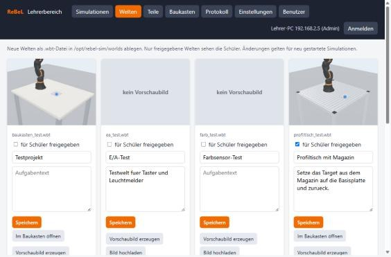

- **Teile:** Liste mit Vorschaubildern. „+ Neues Teil“ öffnet einen Dialog: Name, STEP-Datei, Einlesen; der Container
  erzeugt daraus Netz und Verbindungspunkte (Flächen, Bohrungen, Kanten, Ecken) für den Baukasten, danach zeigt der
  Dialog die Vorschau. Gewinde und Normteile machen das Einlesen langsam, besser ohne exportieren. Die Vorschaubilder
  rendert der Browser einmal aus dem Netz und legt sie im Container ab (`teile/<name>/vorschau.png`).
  **Bearbeiten** öffnet ein Teil:
  - **Neue STEP-Datei einlesen** aktualisiert es, z.B. nach einer Änderung in Onshape. Die Verbindungspunkte, an denen
    etwas hängt, sucht der Container im neuen Modell wieder (gleiche Ebene, Achse, Kante oder Ecke); Roboterumgebungen und
    eigene Greifer mit dem Teil werden neu gerechnet. Fehlt ein Punkt im neuen Modell, ändert sich erst einmal nichts und
    der Dialog nennt die betroffenen Verbindungen. **Trotzdem ersetzen** übernimmt das neue Modell, die genannten Teile
    stehen dann im Baukasten als „offen“ und müssen neu verbunden werden. Laufende Simulationen zeigen das neue Teil nach
    „Neu starten“.
  - **Teil löschen** geht nur, solange das Teil in keiner Roboterumgebung und keinem eigenen Greifer steckt.

  Gelöschte und ersetzte Teile landen in `teile/papierkorb/<name>-<zeit>/` (zum Zurückholen den Ordner wieder nach
  `teile/<name>` verschieben). Mitgelieferte Teile legt das nächste Update wieder an, wenn sie fehlen.

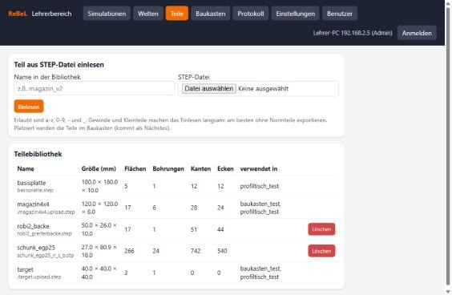

- **Baukasten:** siehe nächster Abschnitt.
- **Protokoll:** wer wann was gemacht hat.
- **Einstellungen** (nur Admins): höchstens gleichzeitige Simulationen, Ende ohne iRC, Stundenenden und das
  **Logo** oben links (PNG, JPG oder SVG hochladen und anklicken; „kein Logo“ zeigt nur den Schriftzug).
- **Benutzer** (nur Admins): Konten mit den Rollen Admin oder Lehrkraft, vorläufige Passwörter.

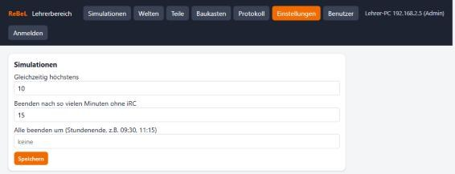

## 8. Baukasten

Im Lehrerbereich unter **Roboterumgebungen** auf „+ Neue Roboterumgebung“ oder bei einer vorhandenen auf
**Baukasten**: Roboterumgebungen aus Teilen der Teilebibliothek zusammenstellen, ohne Webots zu öffnen. Aufgebaut wie
gängige CAD-Programme (z.B. Onshape): oben die **Werkzeugleiste**, links der **Teilebaum**, in der Mitte das 3D-Bild,
rechts schwebend die **Eigenschaften** des gewählten Teils. Eingefügt und eingestellt wird immer in einem Dialog.
**← Roboterumgebungen** führt zurück in den Lehrerbereich; ungespeicherte Änderungen meldet der Browser vorher.

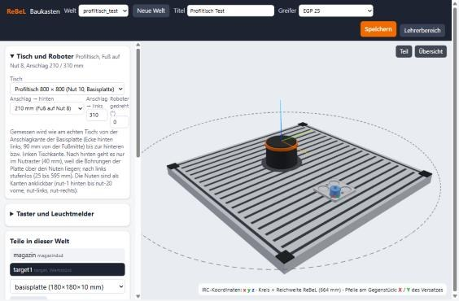

**Neu:** Titel, Dateiname (wird aus dem Titel vorgeschlagen) und Tisch wählen. Bis zum ersten Speichern steht oben
„nicht gespeichert“; ein Klick darauf ändert den Namen.

**Tisch** (Werkzeugleiste oder Teilebaum)
- **eben, Maße frei:** Länge, Breite, Höhe (z.B. −100 bei einem 100-mm-Sockel), Lage des Roboters.
- **Profiltisch 800 × 800** (Bosch Rexroth, Nut 10, Basisplatte): gemessen wird wie am echten Tisch von der
  Anschlagkante der Basisplatte zur hinteren und linken Tischkante. Nach hinten nur im Nutraster (40 mm),
  nach links stufenlos. Die Nuten sind als Kanten anklickbar (`nut-1` hinten bis `nut-20` vorne).
- „Links“ und „vorne“ gelten aus Sicht des Roboters (vorne = Blickrichtung bei 0°).

**Teile platzieren** (wie Mate Connectors in Onshape)
1. **Teil** öffnet die Teilebibliothek als Kacheln mit Vorschau und Suche; ein Klick fügt das Teil ein.
   Es steht zuerst neben dem Tisch. **Sensorfläche** fragt im Dialog nach Art, Beschriftung, DIn und Größe.
2. **Punkt am Teil** anklicken (Fläche, Bohrung, Kante oder Ecke), dann das **Gegenstück** (Tisch, Nut,
   Roboterfuß oder ein anderes Teil). Die beiden Punkte werden aufeinandergelegt.
3. Mit **X/Y/Z** verschieben (Pfeile rot/grün am Gegenstück), drehen (um die blaue Achse), **kippen** um die rote
   bzw. grüne Achse (z.B. ein Teil auf die Seite legen, Knöpfe +90°), ggf. umdrehen (auf den Kopf).
4. **Name** (so heißt das Teil in der Simulation, in der Einteach-Hilfe und auf dem Schild im 3D-Bild; Enter oder
   Klick daneben übernimmt ihn), **Aufbau** (fest) oder **Werkstück** (greifbar, Farbe, Masse).
5. **Speichern**: Die Roboterumgebung wird erzeugt, Webots rendert ein Vorschaubild. Danach im Lehrerbereich freigeben.

**Rechtsklick** auf ein Teil (im Baum oder im 3D-Bild): Umbenennen, Teil zeigen, Punkt oder Gegenstück neu wählen,
Verbindung lösen, Entfernen. **Esc** bricht das Anklicken ab, schließt Dialoge und hebt die Auswahl auf.

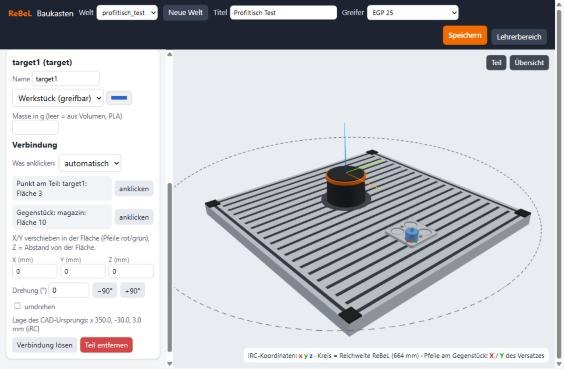

Hängt ein Teil an einem anderen, wandert es mit, wenn sich das andere ändert.

**Aufbauplan** (Werkzeugleiste): Draufsicht des Tischs zum Aufbauen am echten Tisch. Hinten ist oben; „links“ gilt aus
Sicht des Roboters und liegt deshalb im Bild rechts. Zu sehen sind die Nuten 1–20, der Roboterfuß mit Blickrichtung,
die Anschlagkante der Basisplatte (orange) und jedes Teil als Umriss mit Nummer. Aufbauten und Sensoren haben
Maßpfeile zur hinteren und linken Tischkante, Werkstücke erst beim Zeigen auf ihre Zeile. Die Tabelle daneben nennt je
Teil den Abstand von hinten und von links (bis zur nächsten Außenkante), Breite × Tiefe und die Nuten, über denen es
liegt. **Drucken** gibt den Plan auf A4 quer aus.

**Kollisionen** (Werkzeugleiste oder Teilebaum): Die Simulation prüft etwa 10-mal je Sekunde, ob Greifer, Backen, das
gegriffene Teil oder der Roboterarm Tisch, Aufbauten oder Werkstücke berühren. Der Arm wird dabei mit vereinfachten
Hüllkörpern gerechnet (bis etwa 2 cm, an der Hand gut 1 cm größer als echt), Greifer und Teile genau. Außerdem:
- **Selbstkollision:** der Arm faltet sich über Fuß oder Drehteller, oder Greifer bzw. gegriffenes Teil stoßen gegen den
  Arm. Wegen der Hüllkörper zählt das erst ab etwa 1 cm Eindringen (Greifer und Teil: schon bei Berührung). Andere
  Glieder kommen sich innerhalb der Achsgrenzen des ReBeL nie nahe und werden nicht geprüft.
- **Werkstück gegen Werkstück:** ein Teil fällt auf ein anderes (aus mehr als etwa 1 cm Höhe losgelassen) oder wird
  dagegen geschoben. Das ist nur ein Hinweis („Werkstück stößt an“), das Programm läuft weiter. Ruhende Teile, die sich
  berühren (z.B. im Magazin), zählen nie; das gegriffene Teil prüft schon die normale Kollisionsprüfung.

Je Roboterumgebung einstellbar:
- **Kollisionen prüfen** ein/aus (Standard: ein)
- **Reaktion:** wie ein echter Crash (Programm in iRC anhalten, Standard) oder nur melden. Angehalten wird über die
  App WebotsSim (wie bei den Tastern, siehe Abschnitt 9); ist sie am Schüler-PC nicht freigeschaltet, steht in der
  Meldung „Programm konnte nicht angehalten werden“.
- **Sicherheitsabstand** (Standard 2 mm): so nah darf der Roboter an Tisch und Teile kommen. Zwischen dem Greifer und
  dem Teil, das er gerade greift oder eben losgelassen hat, zählt nur echtes Eindringen (mehr als 0,5 mm).
- **Ablagetoleranz** (Standard 2 mm): so tief darf ein abgelegtes Teil in die Auflage drücken.

In der Schüleransicht erscheint dann oben eine rote Meldung, z.B. „Kollision: Backe links mit magazin · X 362 Y 14 Z 4 mm“,
und ein roter Punkt an der Stelle; die Meldung bleibt nach dem Ende der Berührung noch 3 s stehen. Die Lehrkraft
bekommt davon nichts mit.

**Crash** (Reaktion „wie ein echter Crash“): Läuft in iRC ein Programm, wird es sofort angehalten. Oben steht dann
„Crash: Greifer mit magazin …“ mit dem Programmnamen und dem Knopf **Kollision quittieren**; die Meldung bleibt, bis
der Schüler quittiert. Startet er das Programm vorher wieder, hält die Simulation es erneut an. Nach dem Quittieren
den Roboter in iRC von Hand frei fahren: Berührungen mit dem Teil des Crashs zählen so lange nicht, bis der Roboter frei
ist, danach wird wieder normal geprüft. Wird der Roboter von Hand verfahren (kein Programm aktiv), gibt es nur die
Meldung, ohne Anhalten.

**Grenzen** (Werkzeugleiste „Kollisionen & Grenzen“, Teilebaum „Grenzen“): Wegbegrenzungen je Roboterumgebung. Sie
gelten für Greifer, Backen und das gegriffene Teil. Für jede Grenze wählt man die Reaktion: **Stopp** (wie eine
Kollision: Programm anhalten, „Kollision quittieren“) oder **Warnung** (nur Hinweis).
- **Arbeitsraum:** Quader in iRC-Koordinaten (mm, Ursprung Roboterfuß), den die Hand nicht verlassen darf.
  „Tischplatte übernehmen“ setzt x und y auf die Platte und z von der Platte bis 600 mm darüber. Im Bild blau gestrichelt.
- **Sperrzonen:** über „Sperrzone“ in der Werkzeugleiste einfügen und wie eine Sensorfläche an Tisch, Nut oder ein Teil
  hängen (Länge, Breite, Höhe, Beschriftung und Reaktion stehen in den Eigenschaften). In Webots unsichtbar.
- **Achsgrenzen:** engere Grenzen als in iRC für A1–A6, z.B. damit der Arm nicht nach hinten schwenkt. Vorbelegt sind
  die iRC-Grenzen des ReBeL; bleiben sie so, wird nichts zusätzlich geprüft.

Der Aufbauplan zeigt Sperrzonen wie andere Teile (rosa, mit Maßen) und den Arbeitsraum gestrichelt mit seinen Abständen
zur hinteren und linken Tischkante. In der Schüleransicht blendet der Knopf **Grenzen** Arbeitsraum und Sperrzonen als
Drahtgitter ins 3D-Bild ein, dazu eine Liste der Achsgrenzen; die Meldung lautet z.B. „Grenze: Greifer in der Sperrzone
„Schutzgitter““ oder „Grenze: A2 = 65° (erlaubt -80° bis 60°)“. Die Grenzen gelten auch, wenn die Kollisionsprüfung aus ist.

**Greifer** (Lehrerbereich → Greifer): alle Greifer als Karten, oben die eigenen, darunter die Schunk-Greifer, die iRC
mitbringt. Jede Karte zeigt TCP ab Flansch, Backen offen/zu, den Werkzeugnamen in iRC und die Roboterumgebungen, die
den Greifer verwenden. Knöpfe: **Werkzeug für iRC** (ZIP mit Werkzeugdatei samt TCP und Greifer-Ausgängen, 3D-Modellen
und `installieren.cmd`), **Bearbeiten** (öffnet den Greifer-Editor) und **Löschen** (nur, solange keine
Roboterumgebung ihn verwendet).

**Eigenen Greifer bauen** (+ Neuer Greifer): eine Backe aus der Teilebibliothek an den Schunk-Greifer setzen.
1. **Schunk-Greifer** wählen: Schunk EGP 40 (Standard) oder EGP 25. Der Greifer steht geschlossen im Werkzeugsystem von iRC.
2. Backe hinzufügen, Punkt an der Backe und Gegenstück am Backenträger anklicken (EGP 40: zwei M3-Gewinde in
   Greifrichtung). Eine Backe genügt, die zweite ist dieselbe, um die Werkzeugachse gedreht.
3. **TCP** einstellen: Backenspitze oder Mitte der Backe, jeweils mit Versatz entlang der Werkzeugachse, oder ein
   fester Abstand ab Flansch. Das gelbe Kreuz zeigt ihn im Bild. Optional den **Hub je Backe** eintragen (leer = Datenblatt).
4. **Speichern**: Das Robotermodell wird neu erzeugt, der Greifer `egp40_<name>` steht in den Roboterumgebungen zur Wahl.
   Das **Werkzeugpaket für iRC** (ZIP mit XML, Modellen und `installieren.cmd`) bringt denselben TCP nach iRC.

### Punkte für iRC (Greifen, Ablegen, Magazine)

Die Simulation rechnet die Positionen zum Greifen und Ablegen selbst aus und gibt sie als iRC-Unterprogramm mit
Positionsvariablen aus – so lassen sich Programme schreiben, ohne jeden Punkt von Hand einzuteachen.

1. **Greifpunkt**: In der Teileleiste unter dem Werkstück „+ Greifpunkt“ (oder Werkzeugleiste „Greifpunkt“) öffnet den
   Assistenten. **Schritt 1:** die zwei gegenüberliegenden Greifflächen anklicken – bei einer **runden** Fläche (z.B.
   Zapfen) genügt ein Klick, die Gegenseite ergibt sich. Beim Überfahren leuchtet eine nutzbare Fläche grün, sonst grau
   mit Grund. **Schritt 2:** die **Anfahrseite** (ebene Fläche, von der der Greifer kommt; auch schräg oder seitlich; beim
   Zapfen von oben gibt sie nur die Richtung vor). **Schritt 3:** Tiefe (leer = Backen möglichst ganz am Teil, beim
   Zapfen bis kurz vor den Absatz), Abstand der **Vorposition** (Standard 40 mm entlang der Werkzeugachse zurück), bei
   runden Teilen von oben die Drehung der Backen (0 = A6 dreht kaum), Name der Variablen. Gewählte Greifflächen bleiben
   grün, die Anfahrseite blau. Der Greifpunkt steht danach als Unterobjekt „Greifpunkt“ unter dem Werkstück, ebenso seine
   Ablagen. Wird eine runde Fläche nicht erkannt, das Teil unter „Teile“ mit derselben STEP-Datei aktualisieren.
2. **Ablage**: „+ Ablage“ setzt ein durchsichtiges Abbild des Werkstücks; dann die Zielstelle anklicken (z.B. den Boden
   einer Magazintasche). Die Ablage nutzt den Greifpunkt des Werkstücks. In der Webots-Welt erscheint sie nicht.
3. **Magazin** (Baum „Magazine“ oder bei einer Ablage „Magazin …“): drei Ablagen als **A** (erste Tasche), **B** (letzte
   der ersten Reihe), **C** (erste der letzten Reihe) und die Anzahl Spalten (A nach B) und Zeilen (A nach C). iRC fährt
   das mit dem Matrix-Befehl ab; im 3D-Bild zeigen blaue Punkte alle Taschen.
4. Im 3D-Bild zeigen grüne Kugel, Strich und Backen jeden Punkt mit Vorposition; **pink** heißt: es gibt einen Hinweis.
5. **Lehrerbereich → Roboterumgebung → „Punkte für iRC …“**: Prüfbericht (Erreichbarkeit innerhalb der Achsgrenzen,
   Greifer oder Backen stoßen an Tisch, Aufbau oder Nachbarteil, Teil zu breit für den Greifer) und **Herunterladen**.
   Das ZIP enthält `<welt>_punkte.xml` (Unterprogramm), `<welt>_beispiel.xml` (startet in `pHome`, greift, legt ab, fährt das Magazin ab, endet in `pHome`),
   `installieren.cmd` (kopiert beide in den Programmordner von iRC) und `LIESMICH.txt` mit allen Variablen.
   `pHome` ist die Home-Stellung von iRC (A1…A6 = 0 0 90 0 90 0) und steht als erste Variable im Unterprogramm;
   jedes Programm soll dort starten und enden.

In iRC dasselbe Werkzeug wählen wie in der Roboterumgebung (TCP), dann im eigenen Programm zuerst das Unterprogramm
aufrufen und danach die Variablen nutzen: Gelenkbewegung zu `<Name>_vor`, linear zu `<Name>`, Greifer, linear zurück.
Hinweis: Die Reihenfolge der Winkel A/B/C ist noch am echten iRC zu bestätigen; senkrechte Griffe von oben stimmen sicher.

## 9. Taster, Leuchtmelder und Sensoren

Voraussetzung: App „WebotsSim“ in iRC (Abschnitt 5). Nummern immer **wie in der iRC-Anzeige** (DIn21, DOut32).

**Taster und Leuchtmelder** (Baukasten, Abschnitt „Taster und Leuchtmelder“)
- Taster unten links: Beschriftung, DIn, **Schließer/Öffner**, **tastend/rastend**. Ein Öffner meldet ungedrückt 1;
  ein kurz angetippter Taster bleibt mindestens 0,3 s gedrückt, damit iRC ihn sicher sieht.
- Leuchtmelder unten rechts: Beschriftung, DOut, Farbe, auf Wunsch umgekehrt.

**Sensorfläche** (Baukasten, „+ Sensorfläche“): ein durchsichtiger Quader, der wie ein Teil platziert wird.
Die Unterseite ist schon gewählt; nur noch das Gegenstück anklicken.
- **Belegt-Sensor:** meldet, sobald ein Werkstück mindestens 0,5 mm in den Quader ragt (Schließer oder Öffner).
  Die Höhe bestimmt, ab wann ein Teil zählt.
- **Farbsensor:** erkennt die Farbe des Werkstücks (rot, grün, blau, gelb, weiß, schwarz; die nächste zur Farbe
  im Baukasten, sonst „keine“). Ausgabe wahlweise **ein Eingang je Farbe** oder **Farbcode über Bits**
  (Zahl je Farbe, 0 = keine Farbe, Bit 0 auf dem ersten DIn).

| Belegt-Sensor | Farbsensor (blau = Code 2) | Sensorfläche in der 3D-Ansicht |
|---|---|---|
| 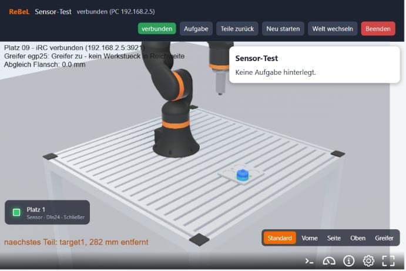 | 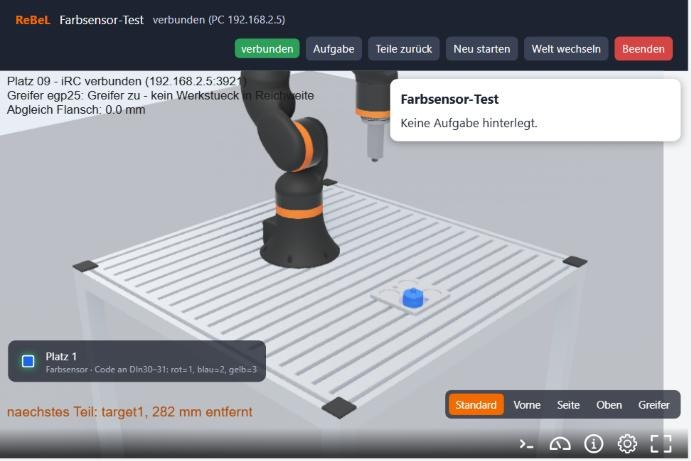 | 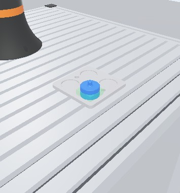 |

**Material** (Eigenschaften eines Aufbaus oder Werkstücks): Kunststoff (PLA, Standard), Stahl, Edelstahl, Aluminium,
Messing oder Holz. Es bestimmt das Aussehen (metallisch oder matt; die Farbe wird passend vorgeschlagen und bleibt
änderbar), die Masse von Werkstücken (aus Volumen × Dichte, wenn keine Masse eingetragen ist) und vor allem, ob
Näherungssensoren das Teil erkennen.

**Näherungssensoren** (Werkzeugleiste „Näherung“): induktiv oder kapazitiv, Bauform M12 oder M18, bündig oder nicht
bündig eingebaut. Der Sensor ist ein Zylinder mit der aktiven Fläche oben (Kappe: induktiv blau, kapazitiv orange).
Im Dialog wählt man die **Befestigung**:

- **Halter in der Nut, quer** bzw. **entlang der Nut** (Standard beim Profiltisch): Halter und Sensor werden
  zusammen auf die Nut vor dem Roboter gesetzt; eine andere Nut einfach anklicken. Der Halter sitzt mit seiner Feder
  verdrehsicher in der Nut, der Sensor
  liegt waagerecht (Achse 25 mm über dem Tisch bei M12, 30 mm bei M18), die aktive Fläche 30 mm vor der Wand.
  Versatz X des Halters = Lage entlang der Nut, Drehung 180° = Sensor schaut in die Gegenrichtung. Wechselt man
  beim Sensor die Bauform, wechselt der Halter mit.
- **ohne Halter**: auf Tisch oder Fläche (steht senkrecht) oder mit der Achse in die Bohrung eines eigenen Teils
  („Was anklicken: Bohrung“).

Die Halter (`naeherung_halter_m12_quer` usw.) liegen in der Teilebibliothek; im Lehrerbereich unter **Teile** →
Halter anklicken → **STEP herunterladen** gibt die Datei zum Drucken (auch in `cad/halter/`). Befestigt wird der
Halter mit zwei M5-Schrauben und Nutensteinen für Nut 10, der Sensor mit seinen beiden Muttern an der 6 mm dicken
Wand. Maße ändern: `tools/halter_naeherung.py` (braucht gmsh) anpassen und neu erzeugen. Der Sensor schaltet,
wenn eine Werkstück-Oberfläche im Sensordurchmesser näher als **Sn × Materialfaktor** vor der aktiven Fläche liegt, auch
ein gegriffenes Teil; einmal geschaltet, fällt er erst bei 10 % mehr Abstand ab.

| Material | induktiv | kapazitiv |
|---|---|---|
| Stahl | 1,0 | 1,0 |
| Edelstahl | 0,7 | 1,0 |
| Messing | 0,5 | 1,0 |
| Aluminium | 0,4 | 1,0 |
| Kunststoff | – (nie) | 0,5 |
| Holz | – (nie) | 0,4 |

Sn ist mit Datenblattwerten vorbelegt (induktiv M12 2/4 mm, M18 5/8 mm; kapazitiv M12 4/8 mm, M18 8/12 mm, jeweils
bündig/nicht bündig) und lässt sich ändern; die Eigenschaften zeigen die Schaltabstände je Material. Eingang (DIn) und
Schließer/Öffner wie bei den Sensorflächen. In der Schüleransicht steht jeder Sensor links mit gelber LED und dem
Abstand des erkannten Teils; im 3D-Bild leuchtet die LED am Sensor.

Fehlt die App in iRC, steht unter den Tastern ein Hinweis („App WebotsSim … nicht freigeschaltet“).
Laufende Simulationen übernehmen geänderte Taster und Sensoren nach **Neu starten**.

## 10. Update

- Auf dem Proxmox-Host das Skript aus Abschnitt 3 erneut starten und **„Vorhandenen Container aktualisieren“** wählen,
- oder im Container: `rebel-sim-update`.

Das Update holt den neuesten Stand aus diesem Repository und richtet ihn ein. **Welten, Teile, Konten,
Einstellungen und das Robotermodell bleiben erhalten.** Laufende Simulationen nutzen den neuen Stand erst nach
„Neu starten“; am besten außerhalb des Unterrichts aktualisieren.

## 11. Befehle im Container

| Befehl | Zweck |
|---|---|
| `rebel-sim-update` | Update aus dem Repository |
| `rebel-sim-einrichtung` | Einrichtungscode zeigen (gilt bis zum ersten Konto); `--neu` erzeugt einen neuen |
| `rebel-sim-modell /root/irc-daten.zip` | Robotermodell aus iRC-Daten erzeugen (sonst im Einrichtungsassistenten hochladen) |
| `rebel-sim-admin <name>` | Admin-Konto anlegen oder Passwort neu setzen; `--liste` zeigt die Konten |
| `rebel-sim-platz liste` | laufende Simulationen |
| `rebel-sim-platz anlegen 99 192.168.3.11 rebel_tisch.wbt dauerhaft` | fester Platz, z.B. Zwilling des echten ReBeL |
| `journalctl -u rebel-sim-web` | Protokoll der Webseite und des Verwalters |
| `rebel-sim-tls` | HTTPS-Zertifikat prüfen bzw. erneuern (läuft auch automatisch) |
| `systemctl disable --now rebel-sim-firewall` | Firewall abschalten (Fehlersuche); `enable --now` schaltet sie wieder ein |
| `journalctl -u rebel-sim@01`, `/var/log/rebel-sim/platz-01.log` | Protokoll einer Simulation |

Wichtige Orte: `/opt/rebel-sim` (Programm, Git), `/opt/rebel-sim/worlds` und `/opt/rebel-sim/teile`
(Welten und Teile, nicht im Git), `/etc/rebel-sim/verwalter.json`, `/var/lib/rebel-sim` (Konten, Protokoll,
Einstellungen, iRC-Daten).

## 12. Fehlersuche

| Problem | Ursache und Abhilfe |
|---|---|
| „warte auf iRC“, Ampel gelb | iRC auf dem Schüler-PC nicht gestartet, Firewall-Regel „robotcontrol“ gilt nicht im Domänenprofil, oder Port 3921 im Netz gesperrt. |
| Ampel rot, Roboter steht | Simulation hängt: **Neu starten**. |
| Taster ohne Wirkung, Hinweis „nicht freigeschaltet“ | App WebotsSim in iRC installieren und aktivieren; Port 5000 zum Schüler-PC freigeben. |
| iRC startet nicht, „Datenverzeichnispfad…“ | Windows-Konto ohne Umlaut verwenden. |
| Falscher PC erkannt / „nicht deine Simulation“ | NAT oder Proxy zwischen Schul-PC und Container. |
| 3D-Ansicht bleibt leer | Browser ohne Internet (WebotsView.js) oder Port 80 gesperrt. |
| Lehrerbereich: Seite „Verschlüsselte Verbindung“ mit Anleitung, oder Browser warnt bei https | Stammzertifikat auf diesem PC noch nicht installiert (Abschnitt 7), oder der Container ist in ein anderes Netz umgezogen (neues Stammzertifikat installieren). |
| Lehrerbereich über https nicht erreichbar | Port 443 im Netz gesperrt; `journalctl -u rebel-sim-web` zeigt, ob HTTPS läuft („HTTPS auf Port 443“). |
| Greifer greift ins Leere | Einteach-Hilfe beachten: Teil zu breit für die Backen, Greifer drehen (A6) oder Höhe anpassen. |
| Teil wird nach dem Zurücklegen nicht mehr gegriffen | Es wurde zu tief in einem Aufbau abgelegt (z.B. unter dem Boden einer Magazintasche). Die Simulation hebt es jetzt auf die Auflage und schreibt ins Protokoll, um wie viel; den Ablegepunkt in iRC höher setzen. |
| Abgleich zeigt große Abweichung | In iRC das passende Werkzeug wählen (TCP), sonst vergleicht der Abgleich mit dem Flansch. |
